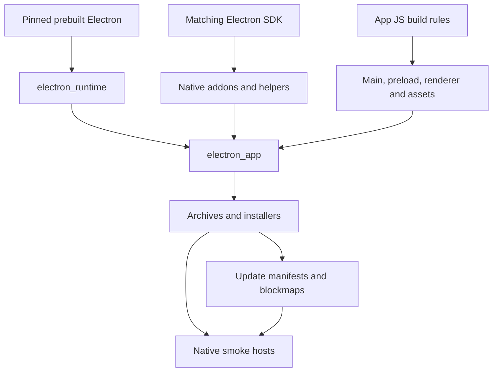

# RFC: native Electron app rules

Build apps around integrity-pinned prebuilt Electron distributions. Bazel owns
app bundling, native addons, assembly, installers and update metadata. Electron,
Chromium and Electron's embedded Node are not built by this repository.

## Ownership

The consuming workspace selects the Electron version and declares its runtime
files or archive with integrity hashes. `rules_electron` owns app layout, ASAR,
fuses, packaging, signing interfaces and distribution metadata. JS rules own
TypeScript, bundling and npm dependency resolution. No electron-builder process
is hidden inside a Bazel action.

Host build tools use execution configuration. Electron, native addons and helpers
use target configuration. Native addon builds need Electron's matching SDK, ABI
and compiler settings; Node's version alone is insufficient. Packaging tools and
native libraries may build from source using declared Bazel toolchains, separately
from the prebuilt Electron runtime.

## Runtime and app inputs

`electron_runtime(binary, files)` adapts declared runtime files or an archive to
`ElectronRuntimeInfo`. Paths are relative to the distribution root. Core assembly
rules do not download Electron or execute the target runtime.

`electron_app(runtime, package_json, srcs)` assembles declared app files, native
modules and extra resources. Optional ASAR packing supports unpacked sidecars and
integrity metadata. Inputs reject traversal and overlapping destinations; output
modes and timestamps are normalized. The execution Python toolchain is pinned.

Linux/Windows directory layouts and macOS app ZIPs have dedicated assembly paths.
Framework symlinks survive transport. Ad hoc macOS signing uses a declared
execution tool; production signing/notarization requires explicit release inputs.
Installers, release archives and update feeds are separate cacheable targets.

## CI

GitHub Actions orchestrates BB remote tests and cross-builds with organization
keys. The pinned offline execution image and declared LLVM toolchains avoid host
compiler discovery. See [hermeticity](hermeticity.md) and [CI setup](../tools/ci/README.md).

The independent desktop example uses pinned official Electron prebuilts. One split
transition builds Linux x86_64/ARM64, macOS ARM64 and Windows x86_64/ARM64 with GNU
LLVM and MSVC. BB verifies every app's architecture before emitting four archives.
GitHub relays those artifacts within the same workflow run. Linux x64, macOS ARM64
and Windows x64/ARM64 runners execute native smoke; Linux ARM64 is cross-build only.
Native smoke hosts do not compile. MSVC use requires licensed hosts and the explicit
Visual Studio runtime license acknowledgement.

Successful cross-builds, native launch, installer lifecycle and updater behavior
remain separate claims. See [packaging parity](packaging-parity.md) for remaining
release work and [performance](performance.md) for measured costs and limits.
