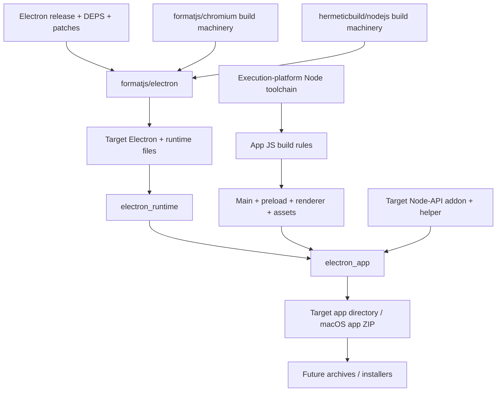

# RFC: native Electron app rules

Status: seven cross-built variants and four native host types verified. Full source-built Electron remains pending.

Build Electron apps as Bazel targets. Cache compiler, generator, app and packaging
actions independently. Build inputs come from declared files and pinned repositories.

## Ownership

`formatjs/electron` owns source pins, patches, generators, native libraries and
runtime linking. `rules_electron` owns app layout, ASAR, runtime selection,
installers and distribution metadata. Existing JS rules own TypeScript, bundling
and npm dependency resolution. No electron-builder subprocess hidden behind one
Bazel action.

Electron selects its Node, Chromium and V8 dependency closure. Reuse build
machinery from hermeticbuild/nodejs and formatjs/chromium without substituting
their current dependency versions. Host Node tools use execution configuration;
Electron and native addons use target configuration. Native addon integration
must include Electron's headers, ABI and build flags, beyond Node's version alone.

## Initial API

`electron_runtime(binary, files)` adapts declared source-build outputs into
`ElectronRuntimeInfo`. Files map to paths relative to Electron's distribution
root. Explicit runtime dependency keeps source version visible at the app target;
runtime toolchain selection can follow once a real source runtime exists.

`electron_app(runtime, package_json, srcs)` writes one directory artifact. App
files map to `resources/app`, retaining renderer/preload paths. Optional ASAR
packs those files with per-file SHA256 block hashes; explicit unpacked files sit
alongside the archive. Extra resources remain outside ASAR. Assembly copies
inputs, rejects traversal and overlapping destinations, normalizes modes and
timestamps. No host filesystem discovery or target execution. Pinned Python
executes the assembly action. App/resource mappings accept declared tree artifacts;
their regular files expand under the mapped prefix. Directory symlinks fail;
Bazel input-projection file symlinks are dereferenced into regular output files.
Runtime adapters still require explicit regular-file mappings.

Linux v1 fuse settings patch only the output binary, leaving source inputs alone.
Unknown, removed, truncated or ambiguous fuse wires fail. Only supported settings
are exposed; embedded ASAR integrity/signature metadata is outside this feature.

Linux/Windows directory layouts and macOS framework/helper bundle structure have
dedicated assembly paths. macOS re-signs ad hoc using an execution-platform tool
and returns a ZIP preserving framework symlinks. Release signing, Windows PE
icons and remaining platform installers still need dedicated rules. Setuid sandbox packaging also needs a format that carries
installation permissions. Native runtime smoke must use a working sandbox.

## Source integration

Source-built Electron remains unlinked. The
[Electron overlay](https://github.com/formatjs/electron/blob/main/docs/source-build.md#full-v8-engine-and-snapshots)
now builds and runs the complete patched V8 engine, inspector and generated
snapshots. Its new native targets contain 1,453 C++/assembly units, reusing
existing base libraries and native generators. Matching source-built dependencies
include ICU, PartitionAlloc, Temporal Rust, Protobuf, Perfetto and compression/SIMD
libraries. Electron builtin JS, webpack bundles, patched libuv/BoringSSL and
eleven Node support libraries also build.

[4516ed7 components](https://formatjs.buildbuddy.io/invocation/4d39e515-418d-4f13-a1ec-2a4b5484c4d0),
[BCR consumer](https://formatjs.buildbuddy.io/invocation/ec9a0537-868a-4182-9ec0-ded5e613b4ef)
and [cross checks](https://formatjs.buildbuddy.io/invocation/4340b427-110a-46b5-a4be-84f4828020d0)
passed. The runtime probe uses actual generated snapshots and declared ICU data;
it executes JS, Wasm, Intl, Rust-backed Temporal and inspector evaluation, then
checks context state after collection. Captured pointer compression, sandbox
and tracing flags stay enabled. Generators verify path/mtime reproducibility;
snapshot code generation disables host CPU probing. These full source profiles
remain Linux AMD64.

Patched libnode now builds its 171 C/C++ units with original inspector and
compression dependencies (239 new units total). [40b2baf consumer](https://formatjs.buildbuddy.io/invocation/257b7fb2-b546-4a98-8b6a-6e1cfb45fa73)
passed actual Node environment startup/shutdown, ABI 140, Node-API 10 shared-addon
loading, original-fs, async FS, crypto, Brotli/Zstd, SQLite and inspector evaluation.
A declared compatibility patch keeps the Node platform registered during V8
isolate disposal, matching Electron's existing main-instance ordering. Parent
source trees stay unchanged.

Matching Gin, Base i18n and CED add 56 original C++ units with shared V8/Base/ICU
dependencies. [5bca689 consumer](https://formatjs.buildbuddy.io/invocation/93435deb-d75a-4138-a291-8f1c2c115443)
passed native callbacks, invalid argument rejection, sandboxed ArrayBuffers,
collection/shutdown and Unicode conversion/segmentation. Both ICU and generated
V8 startup data are declared files. This full profile remains Linux AMD64.

Chromium-configured IPCz adds its complete 36-unit core, shared Base/Abseil and
original source-set linkage. [c961819 consumer](https://formatjs.buildbuddy.io/invocation/3afbac9c-cb0e-4445-a246-0b6d499ffcde)
passed broker/client binary messaging, receive-capacity errors, portal transfer,
peer closure and cleanup with the original synchronous reference driver. No
standalone IPCz implementation replaces Chromium's configuration.

Mojo core/platform/embedder and networking now build their captured closure:
1,124 new C/C++ units plus 34 matching BoringSSL PKI units, original generators
and native NSS/NSPR. Shared Base, ICU, IPCz, Protobuf and compression targets stay
reused. [122f977 consumer](https://formatjs.buildbuddy.io/invocation/376c61c9-c0a3-471b-b9a7-2d07d498f510)
passed binary messages, data pipes, shared mappings, SQL, URL/IDNA, suffix/HSTS
lookups and original NSS integrity verification, including corruption rejection.
HSTS tests retain its 70-day expiry policy. This full profile remains Linux AMD64.

Typed Mojo bindings now add 214 C++ units and 29 original Python actions for
Mojo base types and service-manager interfaces.
[8261fc4 consumer](https://formatjs.buildbuddy.io/invocation/9a5dbde4-c22d-47b1-a9b9-c86ec8564d44)
passed real parent/child invitation transport, generated InterfaceProvider
dispatch with embedded-NUL strings, transferred shared-memory coherence,
reply-pipe transfer and malformed-message rejection. Original source headers
stay shared with networking; no substitute transport participates. This full
profile remains Linux AMD64.

Native rendering dependencies now include the full captured FreeType, HarfBuzz,
libpng and libxml roots: 142 C/C++ units with original Chromium settings.
[854f6a7 consumer](https://formatjs.buildbuddy.io/invocation/be89e67e-3a77-4364-917e-c8cd913427de)
passed ligature shaping, glyph rasterization, RGBA PNG roundtrip and XML/XPath
checks. Source archives use exact DEPS commits plus checksums; ICU and zlib stay
shared. This profile remains Linux AMD64.

Fontconfig now adds its full captured 29 C units plus original Rust fontations:
nine new library/proc-macro targets and one libc build script. The shared Rust
profile contains 95 targets from 71 packages; previous 85 Rust records remain
unchanged. Native pinned bindgen preserves the original C headers and Rust
wrapper. [6652729 consumer](https://formatjs.buildbuddy.io/invocation/d79263f3-c960-4981-acad-338cd9b5d328)
passed explicit-config fontations scanning, metadata/charset checks, native
matching, invalid-font rejection and inventory cleanup using only declared
font bytes. Native BCR libuuid supplies UUID support.

Native JPEG, WebP and Wuffs GIF now add 213 product C units. JPEG retains
27 original SIMD assembly runs, using all 81 captured C units of its matching
NASM 2.17rc0 on the execution platform. Assembly output bytes match across
changed paths/mtimes. [a4c1c6a consumer](https://formatjs.buildbuddy.io/invocation/3539d526-2758-4b59-8fc0-06b5fc20d11f)
passed real JPEG SIMD/color, lossless WebP alpha, GIF pixel/frame completion
and invalid-stream checks. This full profile remains Linux AMD64.

Remaining source work includes complete Skia,
electron_lib, Chromium Blink/content
libraries, the other full source profiles and runtime packaging. The
[Chromium build](https://github.com/formatjs/chromium) has a validated Linux browser
and uses the same V8 base revision, `bb294624702efbb17691b642333f06bf5108e600`.
Reuse its native machinery with Electron's patches and captured configuration.

Once Electron links, expose executable plus complete runtime files with stable
relative paths. Consume them here; run a relocated app creating a BrowserWindow,
loading local renderer assets and exercising a preload IPC roundtrip. Existing
fixtures remain the fast packaging regression suite.

Source builds should eventually use the
[source Node toolchain](https://github.com/hermeticbuild/nodejs) for execution
tools. Required bootstrap runtimes must stay explicit. The assembler itself
needs no Node toolchain.

## CI

Follow [rules_formatjs](https://github.com/formatjs/rules_formatjs/blob/main/buildbuddy.yaml):
BuildBuddy workflow triggers for main, pull requests and merge queue; Linux remote
execution, shared cache/BES, five-platform cross-build matrix. Hermetic LLVM
cross-links a native fixture for Linux x86_64/arm64, macOS x86_64/arm64 and Windows
x86_64 (MinGW fixture). Electron's actual Windows runtime needs MSVC; that
toolchain requires an explicitly approved Visual Studio runtime license setting.
Both MSVC CPU variants have native smoke coverage. Assembly uses Linux execution tools.
Linux tests execute assembled fixture after relocation. No cross-target test
execution implied. Add real Electron targets to this matrix as each upstream
source profile becomes available; keep unsupported profiles explicit.

The independent `examples/desktop` workspace provides a generic app built from
scratch, with a real Node-API addon and helper compiled by LLVM. Explicitly
labeled official Electron bootstraps make it runnable before the source runtime
exists. BB Linux workers compile and package every variant. GH downloads the
verified host-specific archives, then native Linux x64, macOS ARM64 and Windows
x64/ARM64 hosts execute sandboxed relocation smoke. Both Windows compiler
variants run on their matching CPU host. Linux ARM64 is cross-built only.

No credentials checked in. Hosted CI requires repository hookup and BuildBuddy
access. Larger source-runtime jobs need separate memory/disk budgets; fixture
budgets do not estimate Chromium compilation costs.

## Next milestones

1. Complete upstream Linux source runtime; consume stable outputs here.
2. Run the existing real sandboxed relocation smoke against that source runtime.
3. Add OS metadata/protocol registration and distribution archives.
4. Complete native execution validation and Electron-specific Node/V8 addon toolchains.
5. Add signing/notarization and installers with explicit release credentials.

## Seven-variant CI handoff

The example split transition builds Linux x86_64/ARM64, macOS ARM64 and Windows
x86_64/ARM64 with GNU LLVM and MSVC. BB Linux executes every build action. One
action verifies all seven binary architectures before emitting four native-host
archives. GH downloads each using validated invocation metadata, CAS digests and
a read-only BB key. GH hosted native runners
only execute smoke; Linux ARM64 remains cross-build only. This follows the public
formatjs/formatjs artifact handoff. See [packaging parity](packaging-parity.md).
