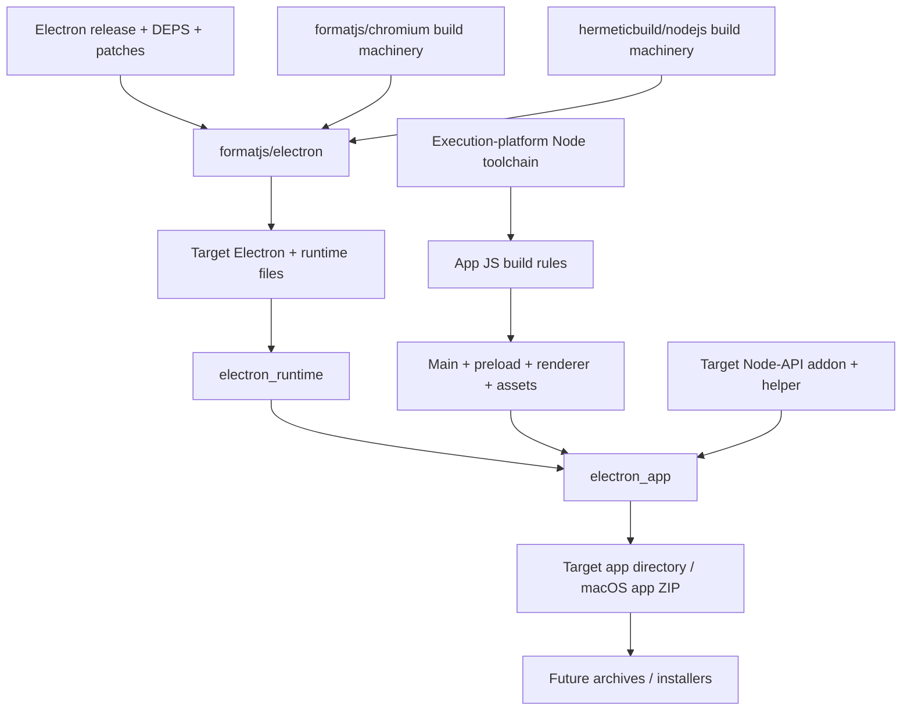

# RFC: native Electron app rules

Status: seven cross-built variants and four native host types verified. Full source-built Electron remains pending.

Build Electron apps as Bazel targets. Cache compiler, generator, app and packaging
actions independently. Build inputs come from declared files and pinned repositories.

## Ownership

`formatjs/electron` owns source pins, patches, generators, native libraries and
runtime linking. `rules_electron` owns app layout, ASAR, runtime selection,
installers and distribution metadata. Existing JS rules own TypeScript, bundling
and npm dependency resolution. No electron-builder subprocess hidden behind one
Bazel action.

Electron selects its Node, Chromium and V8 dependency closure. Reuse build
machinery from hermeticbuild/nodejs and formatjs/chromium without substituting
their current dependency versions. Host Node tools use execution configuration;
Electron and native addons use target configuration. Native addon integration
must include Electron's headers, ABI and build flags, beyond Node's version alone.

## Initial API

`electron_runtime(binary, files)` adapts declared source-build outputs into
`ElectronRuntimeInfo`. Files map to paths relative to Electron's distribution
root. Explicit runtime dependency keeps source version visible at the app target;
runtime toolchain selection can follow once a real source runtime exists.

`electron_app(runtime, package_json, srcs)` writes one directory artifact. App
files map to `resources/app`, retaining renderer/preload paths. Optional ASAR
packs those files with per-file SHA256 block hashes; explicit unpacked files sit
alongside the archive. Extra resources remain outside ASAR. Assembly copies
inputs, rejects traversal and overlapping destinations, normalizes modes and
timestamps. No host filesystem discovery or target execution. Pinned Python
executes the assembly action. App/resource mappings accept declared tree artifacts;
their regular files expand under the mapped prefix. Directory symlinks fail;
Bazel input-projection file symlinks are dereferenced into regular output files.
Runtime adapters still require explicit regular-file mappings.

Linux v1 fuse settings patch only the output binary, leaving source inputs alone.
Unknown, removed, truncated or ambiguous fuse wires fail. Only supported settings
are exposed; embedded ASAR integrity/signature metadata is outside this feature.

Linux/Windows directory layouts and macOS framework/helper bundle structure have
dedicated assembly paths. macOS re-signs ad hoc using an execution-platform tool
and returns a ZIP preserving framework symlinks. Release signing, Windows PE
icons and remaining platform installers still need dedicated rules. Setuid sandbox packaging also needs a format that carries
installation permissions. Native runtime smoke must use a working sandbox.

## Source integration

The [Electron overlay](https://github.com/formatjs/electron/blob/main/docs/source-build.md)
currently builds source components, including builtin JS, webpack bundles,
patched libuv/BoringSSL, V8 base/task libraries and eleven pinned Node support
libraries (136 C/C++ units plus Postject headers, with a linked behavior probe). The
[source and consumer builds at 9395812](https://github.com/formatjs/electron/commit/9395812)
passed on BB. No full runtime links.
The captured Torque compiler now builds 25 C++ units and generates all 1,250
outputs from 246 inputs. Its
[93dc092 component and consumer checks](https://github.com/formatjs/electron/commit/93dc092)
passed on BB, including byte equality across different paths/input mtimes,
engine/Intl/Temporal interfaces and malformed-input diagnostics. Generation uses
declared execution tools and stable relative source locations.
The [1395ef7 bytecode producer](https://github.com/formatjs/electron/commit/1395ef7)
also passed component/consumer tests on BB. Its three captured C++ units generate
the real handler header; a compiled probe checks every opcode and operand scale,
including dense wide dispatch and generation under different output paths.
The [fe62420 ICU profile](https://github.com/formatjs/electron/commit/fe62420)
adds all 445 captured common/i18n C++ units from Chromium's matching ICU revision.
Component and BCR consumer tests passed with ambient data-file access disabled:
the probe rejects corrupt data, loads declared `icudtl.dat`, then checks Unicode,
collation, locale formatting and Chromium word breaks. This source profile is
Linux AMD64; full V8/Electron linking remains pending.
Its next pieces include patched libnode, electron_lib, matching Chromium content
dependencies, snapshots and runtime packaging. The
[Chromium build](https://github.com/formatjs/chromium) has a validated Linux browser,
but its runtime cannot substitute for Electron's patched closure.

Chromium's V8 overlay uses the same `bb294624702efbb17691b642333f06bf5108e600`
base revision as Electron. Its complete native rules can inform the next V8
integration; Electron's V8 patch and captured engine configuration still apply.

Once linking works, upstream should expose executable plus complete runtime file
outputs with stable relative paths. Adapt those outputs here; run a relocated
app creating a BrowserWindow, loading local renderer assets and exercising a
preload IPC roundtrip. Fixtures remain a fast packaging regression suite.

Source builds should eventually use the
[source Node toolchain](https://github.com/hermeticbuild/nodejs) for execution tools.
Bootstrap runtimes, if needed by that compiler graph, must remain explicit.
This initial assembler itself needs no Node toolchain.

## CI

Follow [rules_formatjs](https://github.com/formatjs/rules_formatjs/blob/main/buildbuddy.yaml):
BuildBuddy workflow triggers for main, pull requests and merge queue; Linux remote
execution, shared cache/BES, five-platform cross-build matrix. Hermetic LLVM
cross-links a native fixture for Linux x86_64/arm64, macOS x86_64/arm64 and Windows
x86_64 (MinGW fixture). Electron's actual Windows runtime needs MSVC; that
toolchain requires an explicitly approved Visual Studio runtime license setting.
Both MSVC CPU variants have native smoke coverage. Assembly uses Linux execution tools.
Linux tests execute assembled fixture after relocation. No cross-target test
execution implied. Add real Electron targets to this matrix as each upstream
source profile becomes available; keep unsupported profiles explicit.

The independent `examples/desktop` workspace provides a generic app built from
scratch, with a real Node-API addon and helper compiled by LLVM. Explicitly
labeled official Electron bootstraps make it runnable before the source runtime
exists. BB Linux workers compile and package every variant. GH downloads the
verified host-specific archives, then native Linux x64, macOS ARM64 and Windows
x64/ARM64 hosts execute sandboxed relocation smoke. Both Windows compiler
variants run on their matching CPU host. Linux ARM64 is cross-built only.

No credentials checked in. Hosted CI requires repository hookup and BuildBuddy
access. Larger source-runtime jobs need separate memory/disk budgets; fixture
budgets do not estimate Chromium compilation costs.

## Next milestones

1. Complete upstream Linux source runtime; consume stable outputs here.
2. Run the existing real sandboxed relocation smoke against that source runtime.
3. Add OS metadata/protocol registration and distribution archives.
4. Complete native execution validation and Electron-specific Node/V8 addon toolchains.
5. Add signing/notarization and installers with explicit release credentials.

## Seven-variant CI handoff

The example split transition builds Linux x86_64/ARM64, macOS ARM64 and Windows
x86_64/ARM64 with GNU LLVM and MSVC. BB Linux executes every build action. One
action verifies all seven binary architectures before emitting four native-host
archives. GH downloads each using validated invocation metadata, CAS digests and
a read-only BB key. GH hosted native runners
only execute smoke; Linux ARM64 remains cross-build only. This follows the public
formatjs/formatjs artifact handoff. See [packaging parity](packaging-parity.md).
