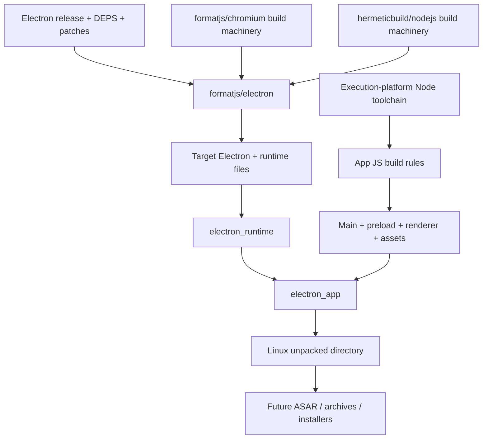

# RFC: native Electron app rules

Status: initial Linux assembly implemented; source runtime integration pending.

Build Electron apps as Bazel targets. Cache compiler, generator, app and packaging
actions independently. Build inputs come from declared files and pinned repositories.

## Ownership

`formatjs/electron` owns source pins, patches, generators, native libraries and
runtime linking. `rules_electron` owns app layout, ASAR, runtime selection,
installers and distribution metadata. Existing JS rules own TypeScript, bundling
and npm dependency resolution. No electron-builder subprocess hidden behind one
Bazel action.

Electron selects its Node, Chromium and V8 dependency closure. Reuse build
machinery from hermeticbuild/nodejs and formatjs/chromium without substituting
their current dependency versions. Host Node tools use execution configuration;
Electron and native addons use target configuration. Native addon integration
must include Electron's headers, ABI and build flags, beyond Node's version alone.

## Initial API

`electron_runtime(binary, files)` adapts declared source-build outputs into
`ElectronRuntimeInfo`. Files map to paths relative to Electron's distribution
root. Explicit runtime dependency keeps source version visible at the app target;
runtime toolchain selection can follow once a real source runtime exists.

`electron_app(runtime, package_json, srcs)` writes one directory artifact. App
files map to `resources/app`, retaining renderer/preload paths. Assembly copies
inputs, rejects traversal and overlapping destinations, normalizes modes and
timestamps. No host filesystem discovery or target execution. Pinned Python
executes the assembly action. Inputs use explicit file mappings initially;
tree-artifact and symlink-aware runtime adapters need a separate contract.

Linux layout only. macOS needs framework/helper app structure and signing order;
Windows needs executable metadata and installer support. These need dedicated
layout implementations. Setuid sandbox packaging also needs a format that carries
installation permissions. Native runtime smoke must use a working sandbox.

## Source integration

The [Electron overlay](https://github.com/formatjs/electron/blob/main/docs/source-build.md)
currently builds source components, including builtin JS, webpack bundles,
patched libuv/BoringSSL and V8 base/task libraries. No full runtime links.
Its next pieces include patched libnode, electron_lib, matching Chromium content
dependencies, snapshots and runtime packaging. The
[Chromium build](https://github.com/formatjs/chromium) has a validated Linux browser,
but its runtime cannot substitute for Electron's patched closure.

Once linking works, upstream should expose executable plus complete runtime file
outputs with stable relative paths. Adapt those outputs here; run a relocated
app creating a BrowserWindow, loading local renderer assets and exercising a
preload IPC roundtrip. Fixtures remain a fast packaging regression suite.

Source builds should eventually use the
[source Node toolchain](https://github.com/hermeticbuild/nodejs) for execution tools.
Bootstrap runtimes, if needed by that compiler graph, must remain explicit.
This initial assembler itself needs no Node toolchain.

## CI

Follow [rules_formatjs](https://github.com/formatjs/rules_formatjs/blob/main/buildbuddy.yaml):
BuildBuddy workflow triggers for main, pull requests and merge queue; Linux remote
execution, shared cache/BES, five-platform cross-build matrix. Hermetic LLVM
cross-links a native fixture for Linux x86_64/arm64, macOS x86_64/arm64 and Windows
x86_64 (MinGW fixture). Electron's actual Windows runtime needs MSVC; that
toolchain requires an explicitly approved Visual Studio runtime license setting.
MSVC validation remains pending. Assembly runs with Linux execution tools for both Linux target CPUs.
Linux tests execute assembled fixture after relocation. No cross-target test
execution implied. Add real Electron targets to this matrix as each upstream
source profile becomes available; keep unsupported profiles explicit.

No credentials checked in. Hosted CI requires repository hookup and BuildBuddy
access. Larger source-runtime jobs need separate memory/disk budgets; fixture
budgets do not estimate Chromium compilation costs.

## Next milestones

1. Complete upstream Linux source runtime; consume stable outputs here.
2. Add real sandboxed Electron relocation smoke and independent consumer workspace.
3. Add deterministic ASAR with unpacked native modules and integrity metadata.
4. Add platform layouts, source-built addons and distribution archives.
5. Add signing/notarization and installers with explicit release credentials.
