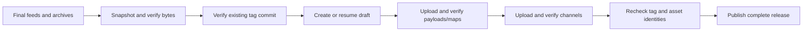

# GitHub release publication

`@rules_electron//electron/tools:publish_github` publishes final update feeds and
optional release archives from an explicit BB Linux release workflow. Ordinary
artifact actions remain offline; credentials enter only the release process.



Create the release tag separately, pointing to the commit used for the BB build.
The tool requires that exact full commit SHA and resolves annotated tags too.
The default tag is `v` followed by the shared feed version; `--tag` also accepts
the version without `v`. Every feed must describe that same SemVer version.

```sh
bazel run --config=bb-workflow @rules_electron//electron/tools:publish_github -- \
  --repository example-org/sample-desktop \
  --commit "$release_commit" \
  --feed "latest-x64.yml=$windows_x64_feed" \
  --feed "latest-arm64.yml=$windows_arm64_feed" \
  --feed "latest-mac.yml=$macos_arm64_feed" \
  --feed "latest-linux.yml=$linux_x64_feed" \
  --feed "latest-linux-arm64.yml=$linux_arm64_feed" \
  --asset "$signed_dmg" \
  --token-env RELEASE_TOKEN
```

Each `--feed` names its existing channel file and native feed directory.
`--asset` adds an opaque final archive, signature or other regular file outside
the update manifests. Names must be ASCII letters/digits, periods, underscores
or hyphens, starting with a letter/digit. GitHub can rename other names, which
would break metadata URLs. Choose the published filenames in the feed rules.
Identical shared files are deduplicated. Conflicting bytes, case collisions,
mixed versions, corrupt payloads/maps and undeclared feed members fail before
network access.

Supply `RELEASE_TOKEN` privately with repository Contents write permission. Its
value never enters rule attributes, outputs or ordinary build actions. API and
upload requests require HTTPS. Authenticated asset downloads may follow HTTPS
redirects; credentials are removed when the origin changes. HTTP is available
only for explicit loopback socket tests.

The publisher creates a draft and uploads all declared assets before making it
public. Every asset is downloaded and checked against the staged bytes. It checks
the final asset identities and tag again before publishing. A retry verifies
existing assets; only empty `starter` assets left by interrupted uploads are
deleted and retried. Published releases are verified without modification.
Unexpected assets or differing bytes fail rather than overwrite another upload.

Use `--draft-only` to stage and verify a draft for review. Rerunning without it
publishes that verified draft. Serialize release jobs per repository/tag; GitHub
does not provide the generic publisher's conditional channel PUT transaction.
Stable releases use `make_latest=legacy`; prereleases are never marked latest.

Generate the application's GitHub provider configuration before signing:

```starlark
electron_update_config(
    name = "github_config",
    provider = "github",
    owner = "example-org",
    repo = "sample-desktop",
    cache_name = "sample-desktop-updater",
    channel = "latest-x64",
)
```

Map its output to `app-update.yml` in `electron_app.extra_resources`. Optional
`host` selects a GitHub Enterprise hostname over HTTPS. `private_repository`
records private-repository intent without embedding a token. Application
credentials for private updates belong to runtime authentication, separately from
publication credentials. Generic configurations retain their existing `url` API.

Windows x64/ARM64 feeds need distinct stable channels such as `latest-x64` and
`latest-arm64`, set in both the app config and feed rule. The pinned 6.8.11
`NsisUpdater` selects the first EXE. Its GitHub prerelease provider derives the
channel from the release tag, so per-CPU Windows prereleases require separate
repositories. Asset filenames must remain unique across every feed in a release.

The [cd8bd1f BB suite](https://formatjs.buildbuddy.io/invocation/3b61744c-8055-46a9-a49a-9e5e4f454585)
passed socket-based protocol tests covering publication ordering, actual downloaded bytes,
public-release immutability, staging/resume, interrupted uploads, redirects,
tag changes, pagination and input conflicts. Native examples also exercise the
real GitHub provider's Atom/API discovery, channel routing, tagged download URLs
and SHA-512 through a local fixture host. Those native checks await hosted
validation; installed-update smoke continues to use generic feeds. Live GitHub
publication remains unverified. API contract:
[releases](https://docs.github.com/en/rest/releases/releases),
[assets](https://docs.github.com/en/rest/releases/assets).
