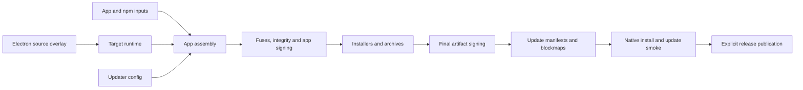

# Release parity goal

Replace the packaging and release contracts needed for an electron-builder
migration. Keep every compile, generator, assembly and packaging action on BB.
Matching native hosts execute smoke tests. Public examples contain only generic
application behavior.

1. **Updater contract.** Generate `app-update.yml`, final-artifact SHA-512/size,
   per-platform channel manifests and external blockmaps. Exercise a pinned real
   `electron-updater` client against a local feed on each smoke host. Discovery
   and blockmap planning come first; install/update execution needs real installers.
2. **Packages and OS integration.** Linux DEB/RPM/AppImage, Windows NSIS/MSIX,
   macOS ZIP/DMG; icons, metadata, shortcuts, protocols and file associations.
   Add install/uninstall and two-version update tests as each target lands.
3. **Runtime and dependencies.** Finish the complete source-built Electron
   runtime in `formatjs/electron`, preserving its pinned Chromium/Node versions.
   Replace the example bootstrap runtime only after native launch passes.
   Add npm-provider integration and general native-addon ABI/toolchain support.
4. **Hardening and release identity.** Embedded ASAR integrity, macOS fuses,
   entitlements, Authenticode, Developer ID, notarization and stapling. Signing
   credentials stay outside ordinary cacheable actions; hashes follow final signing.
5. **Distribution.** Channel/CPU feed layout, release archives and publication
   adapters. Upload artifacts and blockmaps before channel manifests. Publication
   destinations and credentials are supplied by the consuming release workflow.

The [parity checklist](packaging-parity.md) tracks remaining contracts. Source
runtime availability, successful cross-builds, native launch, installer behavior
and successful updates are separate claims; each needs its own evidence.

Hermeticity is an acceptance gate, following [hermeticbuild/nodejs](https://github.com/hermeticbuild/nodejs):
pinned source/tool archives and lockfiles, declared execution toolchains and
sysroots, target/exec separation, explicit action inputs/environment, no network
or host-tool discovery inside build actions, deterministic product bytes. Native
installers and updater execution are tested separately on matching disposable
hosts. Bootstrap runtimes remain labeled until source-built outputs replace them.

After each contract passes that gate, profile it on BB: cold and warm action
times, peak memory, action/cache counts, bytes transferred and artifact sizes.
Optimize measured bottlenecks while retaining reproducibility and behavior tests.
Benchmark/profile data may contain timing; product artifacts may not read clocks.
